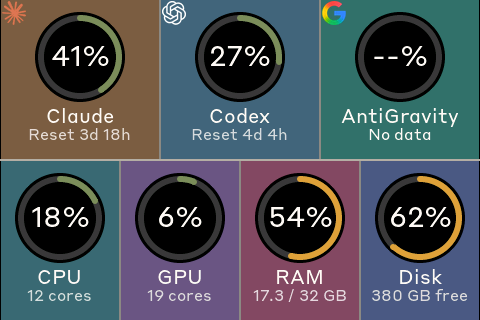

# TURZX 3.5" Screen — Claude / Codex quota + Mac load

Turns a cheap **TURZX 3.5" USB "smart screen"** (the kind sold for CPU/GPU monitoring)
into a desk dashboard for macOS: Claude and Codex usage quota on the top row, CPU,
GPU, RAM and disk on the bottom row. Landscape, 480×320, updates every few seconds.



> Biến màn phụ USB **TURZX 3.5"** (loại bán để xem CPU/GPU) thành bảng theo dõi quota
> Claude, Codex và tải máy Mac. Hướng dẫn tiếng Việt ở [phía dưới](#tiếng-việt).

## What you need

- A Mac (Apple Silicon or Intel) with **Homebrew** and the Xcode command line tools.
- The screen: TURZX / Turing 3.5" IPS, USB `1A86:5722`, shows *"PLEASE RUN THE APP"*
  when powered. Nothing is flashed onto it — the Mac sends it pictures over USB.
- A **USB-A to USB-C cable that carries data**. A USB-C to USB-C cable does not power
  this screen; many A-C cables are charge-only (screen lights up, Mac sees nothing).
- **Claude Code** signed in on this Mac (its token is read from the Keychain item
  `Claude Code-credentials`). **Codex** is optional (`~/.codex/auth.json`).

## Install

```sh
git clone <this repo> && cd <repo folder>
./install.sh
```

Then plug the screen in. The picture appears within ~5 s and comes back by itself after
a reboot. First run downloads LVGL and ArduinoJson (pinned versions) and compiles for
about a minute. macOS may ask once whether `security` may read the Claude Code
Keychain item — choose *Always Allow*.

Options: `--orientation 3` (picture upside down), `--brightness 0-100` (default 70),
`--no-collector` (another program already writes the snapshot). Remove with `./uninstall.sh`.

## What each cell shows

| Cell | Source |
|---|---|
| Claude | weekly quota %, reset countdown — `api.anthropic.com/api/oauth/usage` (a plain GET, uses no quota) |
| Codex | weekly quota %; when it hits 100 % it switches to the credit balance |
| AntiGravity | always `--%` in the shared build (not read) |
| CPU / GPU / RAM / Disk | psutil and `ioreg` on this Mac; Disk = the internal Data volume |

After 30 s without fresh data the machine cells read `No link` and the quota cells
`Old data`, so the screen never shows stale numbers as live.

## How it works

```
host/collector.py  --(every 3 s)-->  ~/Library/Application Support/QuotaFloat/snapshot.json
                                              |
screen/turing_screen  <-----------------------+   draws ui/ (LVGL) at 480x320,
        |                                         sends only changed rows
        +--> libusb bulk OUT 0x03 --> screen (Turing "rev A" protocol)
```

Two LaunchAgents: `com.turzx-screen.collector` and `com.turzx-screen.display`.
Logs: `~/Library/Logs/turzx-collector.log`, `~/Library/Logs/turzx-screen.log`.

## Troubleshooting

| Symptom | Fix |
|---|---|
| Screen says *PLEASE RUN THE APP*, `system_profiler SPUSBHostDataType \| grep UsbMonitor` finds nothing | cable or port carries no data: another A-C cable, a rear USB-A port, push the plug in firmly |
| Screen dark with a C-C cable | expected — use USB-A to C |
| Log says `not accepting data: unplug and replug it` | unplug and replug the screen. This unit stops taking data after the driver restarts (e.g. after re-running `install.sh`); a replug clears it |
| Picture upside down | `./install.sh --orientation 3` |
| Claude cell `--%` | sign in to Claude Code on this Mac; check `~/Library/Logs/turzx-collector.log` |

Why libusb and not the serial port: the screen also appears as
`/dev/cu.usbmodem…`, but macOS's serial driver garbles large frames from this device.
Writing straight to the USB endpoint is clean.

## Credits

The dashboard UI (`ui/`) comes from **Clawdmeter**, an ESP32 desk display for Claude
Code usage; this repo runs that same UI on the Mac and ships it to the USB screen.
Protocol notes from [turing-smart-screen-python](https://github.com/mathoudebine/turing-smart-screen-python).
Graphics library: [LVGL](https://lvgl.io). The bundled bitmap fonts and the
Claude/OpenAI/Google marks belong to their owners; this is a personal, non-commercial project.

---

## Tiếng Việt

**Cần có:** máy Mac đã cài Homebrew và Xcode command line tools
(`xcode-select --install`); màn TURZX 3.5" (cắm vào sáng chữ *PLEASE RUN THE APP*);
**cáp USB-A sang USB-C có truyền dữ liệu**; Claude Code đã đăng nhập trên máy.
Codex không bắt buộc.

**Cài:**

```sh
git clone <repo này> && cd <thư mục repo>
./install.sh
```

Cắm màn vào cổng USB-A. Khoảng 5 giây sau màn hiện bảng số liệu, và tự chạy lại sau
khi khởi động lại máy. Lần đầu script tải LVGL/ArduinoJson và biên dịch khoảng một phút.
Nếu macOS hỏi cho `security` đọc mục Keychain của Claude Code, chọn *Always Allow*.
Màn này không cần nạp firmware, máy Mac gửi hình qua USB.

**Lỗi hay gặp:**
- Màn sáng chữ *PLEASE RUN THE APP* mà không hiện số: cáp không có dây dữ liệu hoặc cắm
  lỏng. Đổi cáp A-C khác, cắm cổng USB-A phía sau, ấn chặt đầu cắm.
- Cáp C-C thì màn không lên nguồn: phải dùng cáp A-C.
- Log báo `not accepting data: unplug and replug it`: rút ra cắm lại màn
  (sau mỗi lần chạy lại `install.sh` đều phải làm một lần).
- Hình bị ngược: `./install.sh --orientation 3`.

**Gỡ:** `./uninstall.sh`.
